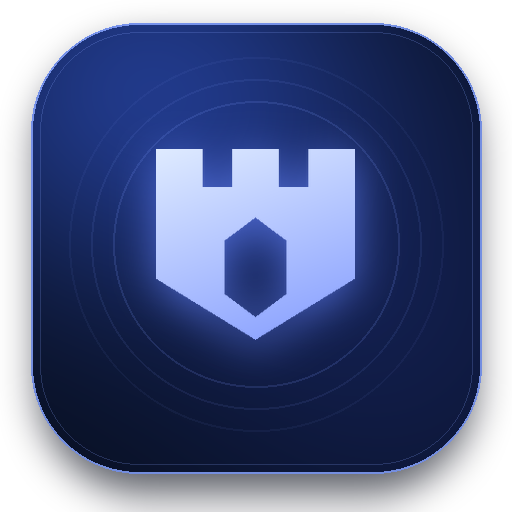
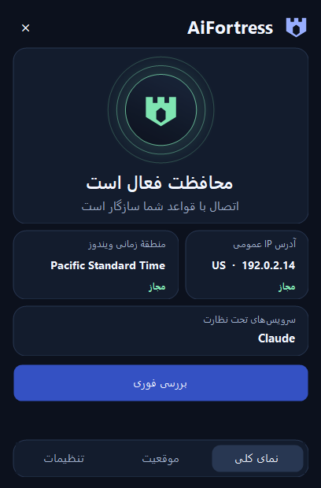
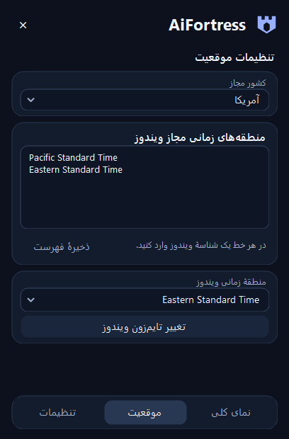

# AiFortress برای ویندوز



[English](README.md)

AiFortress در بخش اعلان‌های ویندوز اجرا می‌شود و کشور IP عمومی و منطقهٔ زمانی ویندوز را با قواعد شما مقایسه می‌کند. **نسخهٔ فعلی فقط از Claude پشتیبانی می‌کند** که شامل Claude Desktop، Claude Code و وب‌سایت‌های Claude است.

## تصاویر برنامه




## دانلود برای ویندوز

فایل مناسب را از [آخرین نسخهٔ منتشرشده](https://github.com/tahadavari/AiFortress/releases/latest) بگیرید.

| فایل | روش استفاده |
| --- | --- |
| `AiFortress-<version>-setup-win-x64.exe` | نصب‌کننده را اجرا کنید. برنامه در Program Files نصب می‌شود، به منوی Start اضافه می‌شود و می‌توانید اجرای خودکار هنگام ورود به ویندوز را انتخاب کنید. |
| `AiFortress-<version>-portable-win-x64.exe` | خود فایل EXE را اجرا کنید. این نسخه بدون نصب است و اجرای خودکار را ثبت نمی‌کند. |

هر دو گزینه تک‌فایلی‌اند، محیط اجرای ‎.NET را همراه دارند و برای ویندوز ۱۰ و ۱۱ نسخهٔ x64 ساخته می‌شوند. درخواست دسترسی مدیر را بپذیرید تا برنامه بتواند قواعد محافظت را اعمال کند. برای باز کردن دوبارهٔ پنل، روی آیکون قلعه کنار ساعت بزنید. فایل `SHA256SUMS.txt` برای بررسی صحت دانلود در بخش Releases قرار دارد.

## استفاده

- در تب **موقعیت** کشور مجاز را انتخاب کنید. با انتخاب کشور دیگر، فهرست منطقه‌های زمانی پیش‌فرض آن کشور بارگذاری می‌شود.
- از فهرست، منطقهٔ زمانی موردنظر را انتخاب کنید و **تغییر تایم‌زون ویندوز** را بزنید. برنامه منطقه را روی ویندوز اعمال و اتصال را دوباره بررسی می‌کند. برای ویرایش فهرست، هر شناسهٔ ویندوز را در یک خط بنویسید و **ذخیرهٔ فهرست** را بزنید. دستور `tzutil /l` شناسه‌های موجود را نشان می‌دهد.
- **بررسی فوری** را در **نمای کلی** یا منوی کنار ساعت بزنید. برای توقف یا ازسرگیری محافظت، روی کنترل قلعه در **نمای کلی** بزنید.
- زبان، فاصلهٔ بررسی، لایه‌های محافظت و فعالیت‌های اخیر در تب **تنظیمات** قرار دارند. پیش‌فرض آمریکا و ۳۰ ثانیه است. تنظیمات در `%ProgramData%\AiFortress\config.json` ذخیره می‌شوند. AiFortress در اولین اجرا می‌تواند تنظیمات قدیمی ClaudeGuard را بخواند.

آیکون قلعهٔ سبز یعنی هر دو بررسی مطابق قواعد هستند. قرمز یعنی شرط مسدودسازی برقرار است. زرد یعنی کشور IP مشخص نشده یا یکی از عملیات محافظت نیاز به پیگیری دارد. خاکستری یعنی هنوز بررسی انجام نشده یا محافظت متوقف است.

### محافظت و حریم خصوصی

بستن پردازه‌های Claude، مسدودسازی با فایروال ویندوز، فایل hosts و سیاست‌های Chrome و Edge جداگانه تنظیم می‌شوند. اختلاف کشور IP یا منطقهٔ زمانی لایه‌های انتخاب‌شده را فعال می‌کند. گزینهٔ **مسدودسازی اگر کشور IP مشخص نشد** همین رفتار را هنگام شکست هر دو سرویس تشخیص کشور اعمال می‌کند. با رفع شرط مسدودسازی، توقف محافظت یا خروج از برنامه، قواعد برداشته می‌شوند.

برای تشخیص کشور، برنامه از Country.is و در صورت نیاز از IPinfo روی HTTPS استفاده می‌کند. نتیجه مربوط به IP عمومی‌ای است که آن سرویس‌ها می‌بینند. برنامه‌هایی با مسیر شبکهٔ متفاوت ممکن است IP عمومی دیگری داشته باشند. فایروال با آدرس‌های به‌دست‌آمده از DNS کار می‌کند که ممکن است تغییر کنند یا میان چند سایت مشترک باشند. [مستندات Country.is](https://country.is/)، [مستندات IPinfo](https://ipinfo.io/developers/ipinfo-api)

## حذف

از هر نسخهٔ Portable خارج شوید، سپس نسخهٔ نصب‌شده را از **Settings → Apps** ویندوز حذف کنید. فایل‌های نصب، میان‌بر، اجرای خودکار و قواعد ثبت‌شدهٔ برنامه پاک می‌شوند. برای نسخهٔ Portable، از منوی کنار ساعت **خروج** را بزنید و فایل EXE را پاک کنید. تنظیمات هر دو نسخه در ProgramData باقی می‌مانند. اگر از نسخهٔ قدیمی ارتقا داده‌اید، سیاست‌های Chrome و Edge را برای ورودی‌های احتمالی باقی‌مانده از آن نسخه بررسی کنید.

## ساخت و انتشار

در ویندوز از SDK ‎.NET 8 و PowerShell استفاده کنید. برای ساخت نصب‌کننده [Inno Setup 6](https://jrsoftware.org/isdl.php) هم لازم است.

```powershell
dotnet build AiFortress.sln -c Release
dotnet run --project tests/AiFortress.Tests -c Release --no-build
./scripts/publish.ps1 -Version 1.1.0
```

نصب‌کننده، EXE نسخهٔ Portable و `SHA256SUMS.txt` در `artifacts/release/<version>/` ساخته می‌شوند. GitHub Actions با Push تگی مانند `v1.1.0`، نصب و حذف برنامه را روی ویندوز آزمایش می‌کند و سپس دو فایل EXE و فایل هش را در Releases منتشر می‌کند. تگ‌هایی مثل `v1.1.0-rc.1` نسخهٔ آزمایشی منتشر می‌کنند. [فایل گردش کار GitHub](.github/workflows/release.yml)

### افزودن زبان

از `src/AiFortress/Localization/en.json` در همان پوشه یک کپی با کد زبان، مثل `de.json`، بسازید. نام نمایشی زبان را در `Name` و جهت نوشتار را در `RightToLeft` مشخص کنید. مقدارهای `Messages` را ترجمه و کلیدها و جای‌نگهدارهایی مانند `{0}` را حفظ کنید. برنامه در بیلد بعدی زبان را خودکار در منو نشان می‌دهد و برای متن‌های ترجمه‌نشده از انگلیسی استفاده می‌کند.

### افزودن سرویس

یک `ServiceProfile` با نام نمایشی، دامنه‌های شبکه و دامنه‌های مرورگر بسازید و آن را به `ServiceCatalog.Supported` اضافه کنید. برای برنامهٔ دسکتاپ یا CLI می‌توانید راهبرد تشخیص پردازهٔ همان سرویس را هم تعریف کنید. سرویس‌های ثبت‌شده در پنل به نمایش درمی‌آیند و همان لایه‌های محافظت ویندوز روی آن‌ها اعمال می‌شوند.
