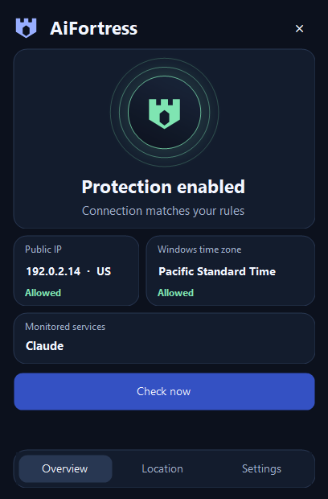
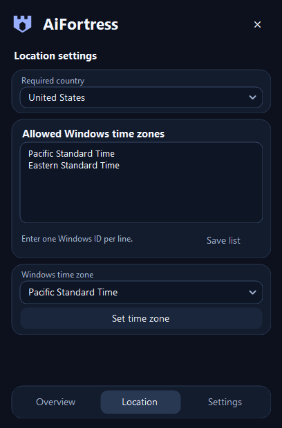

# AiFortress for Windows


[فارسی](README.fa.md)

AiFortress is a Windows notification-area app that checks your public IP country and Windows time zone against rules you choose. **The current version supports Claude only**, including Claude Desktop, Claude Code, and Claude websites.

## Screenshots




## Download for Windows

Choose a file from the [latest release](https://github.com/tahadavari/AiFortress/releases/latest).

| File | How to use it |
| --- | --- |
| `AiFortress-<version>-setup-win-x64.exe` | Run the setup wizard to install into Program Files and add a Start menu shortcut. The wizard offers startup at sign-in. |
| `AiFortress-<version>-portable-win-x64.exe` | Run the EXE directly. This edition needs no installation and creates no startup task. |

Both editions are single-file downloads with the .NET runtime included and target Windows 10 and 11 on x64. Accept the UAC prompt to let AiFortress apply its Windows protection rules. Click the fortress icon in the notification area to reopen the panel. The release includes `SHA256SUMS.txt` for checking either download.

## Use

- Open **Location** to choose the required country. Selecting a different country loads its default list of Windows time zones.
- Choose an allowed time zone and select **Set time zone** to apply it to Windows and run a fresh check. To customize the list, enter one Windows time zone ID per line and select **Save list**. Run `tzutil /l` to see the IDs available on your PC.
- Select **Check now** in **Overview** or the tray menu to check immediately. Click the fortress control in **Overview** to pause or resume protection.
- Open **Settings** for language, check interval, protection layers and recent activity. The defaults are the United States and a 30-second check interval. Preferences are saved in `%ProgramData%\AiFortress\config.json`. If you previously used ClaudeGuard, AiFortress reads its settings until it saves a new file.

The fortress icon is green when both checks match, red when the blocking condition is met, amber when the IP country is unavailable or a protection operation needs attention, and gray before the first check or while protection is paused.

### Protection and privacy

You can independently enable process closing, Windows Firewall rules, hosts entries and Chrome/Edge policies. An IP-country mismatch or a time zone mismatch triggers the enabled layers. **Block if the IP country is unavailable** also triggers them when both location providers fail. Rules are lifted when the blocking condition clears or you pause or exit the app. The activity panel reports Windows operations that fail.

AiFortress queries Country.is and uses IPinfo as an HTTPS fallback to determine the country of the public IP those services see. An app or browser using different network routing can have a different public IP. Firewall enforcement uses dynamically resolved addresses, which can be shared with other sites or change over time. [Country.is API](https://country.is/), [IPinfo API](https://ipinfo.io/developers/ipinfo-api)

## Uninstall

Exit any portable copy, then remove the installed edition from **Settings → Apps**. This removes the installed files, shortcut, startup task and protection rules tracked by AiFortress. For Portable, choose **Exit** in the tray menu, then delete the EXE. Both editions keep saved preferences in ProgramData. If you upgraded from an older build that wrote untracked Chrome or Edge URLBlocklist values, check those browser policies for leftover Claude entries.

## Build and release

Use the .NET 8 SDK and PowerShell on Windows. Packaging the installer also requires [Inno Setup 6](https://jrsoftware.org/isdl.php).

```powershell
dotnet build AiFortress.sln -c Release
dotnet run --project tests/AiFortress.Tests -c Release --no-build
./scripts/publish.ps1 -Version 1.1.0
```

The publishing script writes the installer, portable EXE and `SHA256SUMS.txt` to `artifacts/release/<version>/`. The app regression checks exercise settings migration, Check Now, error recovery and both UI languages. The tagged workflow also installs and uninstalls the setup EXE on the Windows runner before publishing.

The GitHub workflow builds and tests pushes and pull requests. Push a version tag such as `v1.1.0` to publish both EXEs and the checksums to GitHub Releases. Tags with a suffix such as `v1.1.0-rc.1` create prereleases. [Release workflow](.github/workflows/release.yml)

| Directory | Contents |
| --- | --- |
| `src/AiFortress/Core/` | Checks, settings and localization loader |
| `src/AiFortress/Services/` | Profiles for supported AI services and websites |
| `src/AiFortress/Ui/` | Windows Forms and tray controls |
| `src/AiFortress/Windows/` | Windows protection and time zone integration |
| `src/AiFortress/Localization/` | Embedded language catalogs |
| `tests/AiFortress.Tests/` | Windows regression checks |
| `scripts/`, `packaging/` | Release packaging and installation |

### Add a language

Copy `src/AiFortress/Localization/en.json` to a UTF-8 file such as `de.json` in the same directory. Set `Name` to the language’s name as it should appear in the picker, set `RightToLeft` for its writing direction, and translate the values in `Messages`. Preserve the message keys and placeholders such as `{0}`. The next build discovers the new language automatically and uses English for any missing keys.

### Add a service

Define a `ServiceProfile` with a display name, DNS/hosts domains, and browser-policy domains, then register it in `ServiceCatalog.Supported`. A desktop or CLI integration can also supply a process-matching strategy. Site-only profiles can omit that strategy. The registered profiles feed both the Windows protection layers and the monitored-services list in the panel.
